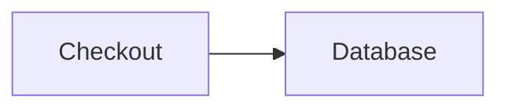

Notebooks Flavored Markdown is the Markdown format for reading, writing, and editing Datadog notebooks. It extends [GitHub Flavored Markdown (GFM)][3] with encodings for notebook content. It also defines how content changes when the notebook editor cannot preserve a Markdown structure.

Use this reference when generating notebook content from an agent, building an integration, or editing Markdown returned by the Notebooks API.

For API authentication, content operations, section scopes, and error handling, see [Work with notebooks through the API][1]. The Notebooks v2 API is in Preview and is subject to change.

## Start here

For most generated notebooks, ordinary Markdown is enough:

```markdown
# Checkout latency investigation

Latency increased after the latest deploy. **Errors are unchanged.**

## Next steps

- [x] Compare latency before and after the deploy
- [ ] Check database connection wait time

| Signal          | Observation |
| --------------- | ----------- |
| Request latency | Increased   |
| Error rate      | Unchanged   |

> [!NOTE] Scope
> This investigation covers production traffic.

See the [runbook](https://example.com/runbooks/checkout).
```

A full notebook's Markdown includes its title as the leading H1, including when carried in a JSON API response. Markdown exports and `text/markdown` API payloads also include notebook metadata as [YAML frontmatter][2].

The examples in this guide show decoded Markdown. When sending it inside JSON, use a JSON serializer to escape newlines, quotes, and backslashes. Markdown escaping and JSON escaping are separate steps.

## Markdown compatibility

Use the [GFM specification][3] for baseline syntax: headings, emphasis, strikethrough, code, links, images, lists, task lists, blockquotes, thematic breaks, and pipe tables. The rules in this guide describe notebook-specific extensions and normalization.

Notebooks normalizes some GFM structures. Table cells, nested blocks, paragraph spacing, and automatic links have specific behavior. Raw HTML is restricted to supported, sanitized structures. GitHub features outside the GFM specification aren't implied by GFM compatibility.

The round-trip goal is to preserve readable content and supported structure. Export can change delimiters, indentation, reference labels, URL escaping, or table syntax. Compare meaning and supported structure, rather than expecting byte-for-byte equality.

## Text, spacing, and code

Headings support levels 1 through 6. Bullet lists, ordered lists, and task lists support nesting where the editor allows lists. Ordered lists preserve each item's written number, including repeats and gaps; another Markdown renderer may display a continuous sequence.

For a hard break, end the line with a backslash. The next line appears directly below it:

```markdown
First line.\
Second line.
```

To start a new paragraph, leave a blank line:

```markdown
First paragraph.

Second paragraph.
```

The same spacing rules apply inside table cells.

Inline code and ordinary fenced code keep their contents literal. Use a fence longer than any run of backticks in its contents. Language identifiers may normalize on export.

`dd-widget`, `mermaid`, and `logs` are [reserved fence identifiers][4]. They select notebook content types, so don't use them as generic syntax-highlighting labels for unrelated code.

Both `md` and `markdown` fences represent literal Markdown source and export as `markdown` fences. Legacy code blocks normalize to editable code, and legacy Markdown widgets export as ordinary document content.

## Links, chips, and cards

Choose the link syntax based on the behavior you want:

| Input                                        | Notebook behavior                                            |
| -------------------------------------------- | ------------------------------------------------------------ |
| `[Runbook](https://example.com/runbook)`     | Ordinary link.                                               |
| `[https://example.com](https://example.com)` | Ordinary link, even though its label is the URL.             |
| A reference link or an HTML `<a>` element    | Ordinary link.                                               |
| `<https://example.com>`                      | Eligible for a chip or card if the destination is supported. |
| Bare `https://example.com`                   | Eligible for the same automatic conversion.                  |
| A URL inside code                            | Literal code.                                                |

An eligible automatic URL becomes a chip within text. It can become a card when it's the only content in a paragraph and the containing structure permits cards. Headings, list items, and table cells keep chips. Content isn't moved out of a container to make room for a card.

Explicit links stay links even when they occupy an entire paragraph. The documented notebook encodings for mentions, dates, dropdowns, and action buttons are exceptions: their destinations identify notebook content and are recognized before generic links.

Exported chips and cards use `<URL>`. A destination that can't use autolink syntax, such as a relative URL, exports as `[URL](URL)` and reimports as an ordinary link. Rich-link reconstruction requires a resolver; unsupported destinations remain links.

Escape link labels as Markdown. In destinations, normalize spaces and angle brackets and escape parentheses and backslashes. Write a literal `&copy;` as `&amp;copy;` to prevent character-reference decoding; leave ordinary query separators such as `&page=2` unchanged. URL-encode individual query values before Markdown escaping.

Older exports can normalize differently: a chip previously encoded as `[URL](URL)` may become a link. The destination and readable content should survive even when presentation changes.

## Tables

Use pipe tables when every row has the same number of cells, the first row is all headers, and later rows are ordinary cells. Each cell must contain one paragraph with no line breaks or explicit column widths.

```markdown
| Service  | Status        |
| -------- | ------------- |
| checkout | Investigating |
| payments | Healthy       |
```

Escape literal pipes as `\|`, including inside code spans and URLs. Empty cells stay empty. Repeated spaces alone don't require HTML.

For richer structure, use HTML table tags with Markdown inside the cells:

```markdown
<table>
<tr>
<td colwidth="120">

Checkout

</td>
<td colwidth="180">

**Investigation notes**

Latency increased after the deploy.

</td>
</tr>
</table>
```

Keep blank lines around Markdown inside table cells. They let Markdown parsing resume between the HTML table tags.

Use `th` for header cells and `td` for ordinary cells. Set widths in pixels on individual cells with `colwidth`, such as `colwidth="120"`. Table captions become prose immediately before the table.

Table cells contain paragraphs with inline formatting. Lists, headings, quotes, and nested tables inside a cell flatten into separate paragraphs in reading order. Their text and supported inline formatting survive; block presentation doesn't. Code blocks become one paragraph of inline code per line, including empty lines. A horizontal rule becomes an empty paragraph.

## Callouts and highlights

Callouts use the `[!TYPE]` blockquote syntax used by [GitHub alerts][5]. Notebooks adds `TARGET`, `CHECK`, `QUESTION`, and `PENDING` types and supports an optional label on the marker line:

```markdown
> [!WARNING] Before restarting
> Capture the current connection count.
```

Recognized types are `NOTE`, `TIP`, `IMPORTANT`, `WARNING`, `CAUTION`, `TARGET`, `CHECK`, `QUESTION`, and `PENDING`. Escape HTML-looking text in labels. Lists inside a callout or blockquote become separate quoted paragraphs.

Highlights use an HTML `mark` element:

```html
<mark data-highlight-color="yellow">Check this before the deploy.</mark>
```

Supported colors are `blue`, `green`, `red`, `yellow`, and `purple`. A missing color defaults to blue; an invalid color doesn't create a highlight. Exports also include a background-color style for renderers that support it. The color attribute carries the notebook meaning.

## Mentions

User and team mentions use resource links with an `@` label:

```markdown
[@handle](https://app.datadoghq.com/organization-settings/users?user_id=USER_ID)
[@team-name](https://app.datadoghq.com/organization-settings/teams?team_id=TEAM_ID)
```

Replace the example origin with the notebook's [Datadog site][6] and the placeholder IDs with real IDs. The destination carries identity. A display name or bare `@handle` alone isn't enough to reconstruct a mention, and user display names aren't fully preserved through export/import.

## Reserved fenced blocks

Place reserved blocks at the document level. They reconstruct notebook widgets only in supported positions. Inside unsupported nested structures, their payload stays ordinary code, or paragraphs of inline code where blocks aren't allowed.

### Widgets

The `dd-widget` fence contains a JSON widget envelope. Document API V2 output includes `id`, `definition`, and applicable `graph_size`, `time`, and `split_by` fields.

For example, add an editable CPU usage graph with this block:

````markdown
```dd-widget
{
  "definition": {
    "type": "timeseries",
    "title": "CPU usage",
    "requests": [
      {
        "q": "avg:system.cpu.user{*}",
        "display_type": "line"
      }
    ]
  },
  "graph_size": "m"
}
```
````

Omit `id` for a new widget so the API assigns one. When editing a returned widget, preserve its ID and payload fields you aren't changing. Use the [widget schemas][7] to construct a new definition and follow the receiving API's rules for new IDs. A preserved invalid definition is still invalid.

Keep the widget envelope with the Markdown that references it. Don't reduce a widget to a screenshot if the next consumer needs an editable graph.

### Mermaid diagrams

````markdown

````

The fence and diagram source are retained as notebook content. Another Markdown renderer may show the source as code.

### Saved logs

A `logs` fence contains a JSON object for one saved log event. Preserve every field, including its message, timestamp, status, tags, attributes, optional `fetchEventId`, and fields you don't recognize. The saved snapshot remains viewable after the source log leaves retention. Malformed JSON remains visible as literal code.

## Images and graph previews

Markdown images can use inline or reference syntax, including images wrapped in links:

```markdown


[](https://example.com/share)
```

The second example shows the shape of a linked preview; reconstructing a graph requires a supported Datadog share URL. Browser graph exports commonly use this form. A preview image by itself can't reconstruct an editable widget. Browser import can also expand a supported automatic share URL alone in a document-level paragraph into widgets; explicit share links stay links.

Browser exports of image widgets can include trailing data-URI references. Document API image widgets use `dd-widget`. Image representation depends on the caller and the caption, sizing, title, or enclosing link it needs to preserve.

**Placement:** Extracted images and linked previews follow their entire containing paragraph, heading, list, table, or quote/callout block in source order. Surrounding text, table structure, and authored empty paragraphs remain intact. Only a standalone paragraph emptied by image extraction is removed.

**Attachment handling:** New inline image bytes are stored as attachments. API writes, including MCP, resolve pending images and finish new attachment uploads before saving the document or returning completed content. An upload failure prevents the write. Remote URLs remain references on the server.

API writes accept nonempty base64 PNG, JPEG, or GIF sources smaller than 4 MiB. This includes image-widget `definition.url` and `definition.url_dark_theme`. Repeated sources can share an upload while retaining separate placements and metadata. Browser paste inserts pending images before uploading; file import waits for completed uploads.

## Dates, dropdowns, and actions

Exports can contain links that encode dates, dropdowns, and actions. Preserve these links when editing returned content. Retain the forms below when editing exports. Their navigation behavior is not a supported API contract, so avoid using them as URL templates for new content.

In this table, `TIMESTAMP`, `TEMPLATE_ID`, `OPTION_ID`, and `…` represent values supplied by the notebook or caller. These are format sketches, not complete payloads.

| Content                  | Encoding                                                                                     | Required context and fallback                                                                                                                                          |
| ------------------------ | -------------------------------------------------------------------------------------------- | ---------------------------------------------------------------------------------------------------------------------------------------------------------------------- |
| Date or datetime         | `[label](?start=TIMESTAMP&hasTime=true)`                                                     | `start` is milliseconds since the UNIX epoch; `hasTime=false` means date only. The label can reflect the exporting user's timezone. Don't infer the timestamp from it. |
| Dropdown                 | `[label](#dropdown:TEMPLATE_ID/OPTION_ID)`                                                   | Requires the matching dropdown template in metadata. An unknown template becomes unlinked label text; a missing or invalid option can normalize to the first option.   |
| Time frame action         | `[label](?type=timeframeAction&start=…&end=…&paused=…&mode=…&color=…&buttonText=…)`          | Query fields carry configuration. Absent optional fields use import defaults.                                                                                          |
| Template-variable action | `[label](?type=templateVarAction&tvarName=…&tvarValues=…&tvarValues=…&color=…&buttonText=…)` | Repeated `tvarValues` carry selections. Preserve all values.                                                                                                           |

Dropdowns can also use reference links:

```markdown
Status: [Investigating][dropdown-1]

[dropdown-1]: #dropdown:TEMPLATE_ID/OPTION_ID
```

Include the reference definition when copying a fragment, or use the inline form. Either form still needs the dropdown template. Reference labels such as `dropdown-1` aren't stable identifiers; the destination carries identity.

## Comments and incident content

Comment anchors are opt-in on both export and import, in workflows that support comment inclusion:

```html
<mark data-comment-id="COMMENT_ID">Anchored text</mark>
<mark data-comment-id="COMMENT_ID" data-comment-status="resolved"
    >Resolved text</mark
>
```

Without comment inclusion, the text survives without its anchors. These annotations don't contain comment bodies, authors, or discussion history. Preserve IDs when carrying anchors through a supported workflow; an anchor alone doesn't create a discussion.

Incident widgets and follow-up lists have dedicated link and snapshot forms. API output can encode them as links to an incident. Browser exports can include summary tables or quoted task lists with incident-specific `link_type` discriminators. Reconstruction depends on the URL and documented shape. Reconstructed incident content is live rather than a frozen copy of the exported summary. Keep these forms intact when editing an export.

## Embedded markup

Use HTML for [rich tables][8] with multiple paragraphs or explicit column widths, keeping Markdown inside the cells. Unsupported HTML tags are treated as literal text.

## Metadata

Markdown exports and `text/markdown` API payloads include notebook metadata as YAML frontmatter, enclosed by `---` at the start of the document. Metadata includes tags, time frame, template variables, and dropdown templates.

```markdown
---
tags:
    - service:checkout
    - team:payments
time:
    start: '2026-10-22T14:00:00.000Z'
    end: '2026-10-22T15:00:00.000Z'
---

# Checkout latency investigation

## Findings

Latency increased after the latest deploy.
```

The Markdown document starts after the closing `---`, with an H1 for the notebook title. The title H1 is included in JSON `attributes.markdown` too, and is not a section in the stored body. Full-document API writes consume it as the title; append fragments and section replacements retain their headings as body content. For title updates and compatibility with frontmatter titles, see [Titles and metadata][9].

Exports can also include read-only metadata such as `created_by`, which is ignored on import.

## Check a Markdown round trip

Test content through the path the integration uses. Browser downloads, paste, file import, and API transformations share the format but have different widget, image, metadata, and link-resolution behavior.

- Import, export, and import again. Check supported content and structure after each cycle, including literal code and empty paragraphs.
- Verify that explicit links stay links and that automatic URLs don't consume surrounding text.
- Include tables with escaped pipes, multiple paragraphs, and any widths the integration emits.
- Keep widget payloads, dropdown metadata, and reference definitions with the content that needs them.
- Check documented fallbacks with missing context and unsupported nesting. A successful parse doesn't prove a faithful round trip.
- Check for incomplete conversion, including unresolved image placeholders and content without a portable encoding. Literal fallback text can preserve source without preserving its structure.

[1]: /notebooks/guide/notebooks_api/
[2]: #metadata
[3]: https://github.github.io/gfm/
[4]: #reserved-fenced-blocks
[5]: https://docs.github.com/en/get-started/writing-on-github/getting-started-with-writing-and-formatting-on-github/basic-writing-and-formatting-syntax#alerts
[6]: /getting_started/site/
[7]: /dashboards/widgets/
[8]: #tables
[9]: /notebooks/guide/notebooks_api/#titles-and-metadata
